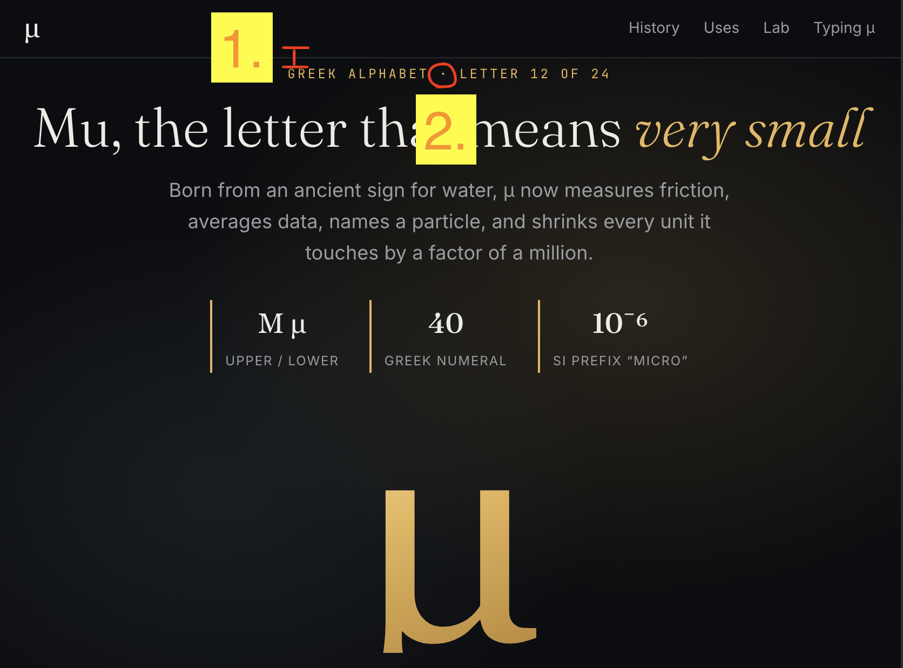
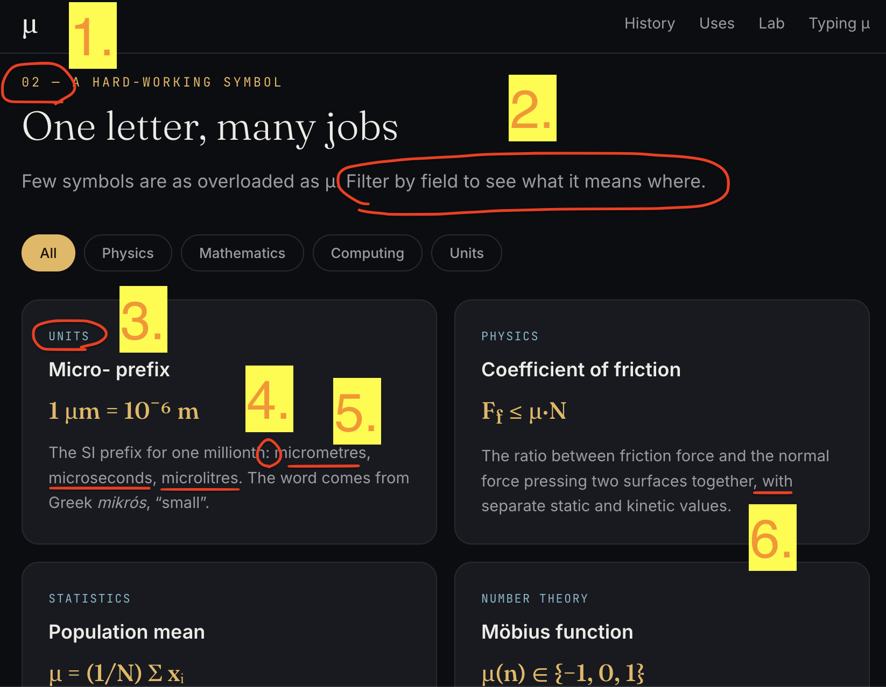
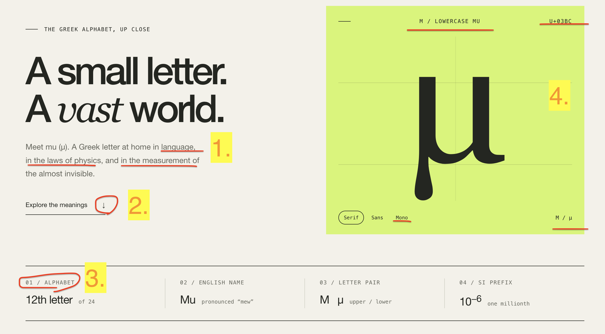
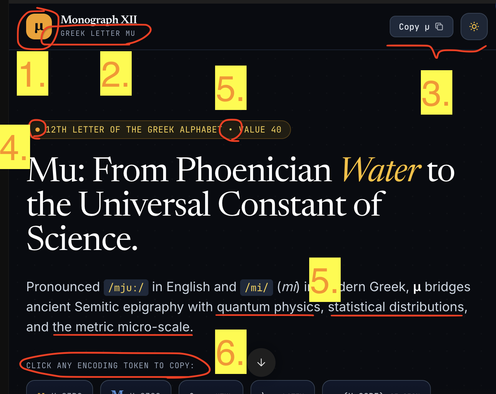

<!-- markdownlint-disable no-inline-html -->
# myoo-skills

<h1 align="center"><samp>
μ&nbsp;&nbsp;&nbsp;&nbsp;&nbsp; 
&nbsp;\&nbsp;&nbsp;&nbsp;&nbsp; 
&nbsp;&nbsp;🐄💨
</samp></h1>

[μ-skills](https://github.com/myoo-ai/skills) is an opinionated set of tools for AI agent harnesses to enhance their efficiency and capabilities, with hopes of making them deliver more quality outputs.

## Who is this for?

Primarily for software engineers (code/software), however some skills can apply to other AI outputs too, like prose (texts/articles) or media (image/video). So basically for anyone who creates with the use of AI.

A lot of these tools are made for the current state of AI, and they might become irrelevant in the next 6 months. Who knows? But, I feel that the need for these tools currently there, and has been there for quite some time now, and so I want to finally close this gap in my workflow.

## Glossary

This document refers to some concepts that might be ambiguous to some readers. My interpretation is the following:

- [AI agent](https://en.wikipedia.org/wiki/AI_agent) is an artificial intelligence program (in most cases, it consists of a [Large Language Model](https://en.wikipedia.org/wiki/Large_language_model) or LLM) that can make decisions, pursue goals, and take actions independent of humans. There are currently many LLMs available, with the primary vendors for these models at the moment being: OpenAI (ChatGPT), Anthropic (Claude) and Google (Gemini).
- [AI harness](https://en.wikipedia.org/wiki/Agent_harness) is the application that humans use to communicate with AI agents. They also provide the AI agents with tools to integrate with the different parts of the system so the agents can deliver the outputs in the expected form and quality. Some popular harnesses include: Codex (OpenAI), Claude Code (Anthropic), Antigravity (Google), Cursor and many more. This repository aims at providing tools that are not AI agent harness-specific, however at the time of writing these tools were only tested in [omp](https://omp.sh).
- [Spec-Driven Development (SDD)](https://specdriven.ai/) is a methodology that prioritizes the creation of precise, machine-readable specifications over immediate coding. As AI commoditizes code generation, the engineering bottleneck has shifted from _writing syntax_ to _defining intent_. SDD addresses this by treating the specification as the primary source of truth from which code, tests, and documentation are derived.
- [Vibe coding](https://en.wikipedia.org/wiki/Vibe_coding) is the software development practice assisted by AI where the software developer describes a project or task in natural languages to an AI agent, which generates source code automatically. Vibe coding may involve accepting AI-generated code without thorough review of the output, instead relying on results and follow-up prompts to guide changes.
  - This repo aims at defining a healthy compromise between these two practices, so that AI agents are able to invent or use existing standards provided by tools in this repo to create outputs of a higher quality, see ["The problem"](#the-problem).
  - See also ["Comparison: SDD vs. Vibe Coding" section in SDD](https://specdriven.ai/)
- AI output. While originally, AI models started as image or text-only models, nowadays these models are able to interact with a wide range of other media formats which allows them to produce diagrams, presentations, documents, e-mails, interact with UI or other applications via [MCP servers](https://en.wikipedia.org/wiki/Model_Context_Protocol) or [tools](https://www.aihero.dev/ai-coding-dictionary/tool) and many other content formats more easily. Here, we refer to anything that was AI generated as the (AI) output.
- [Prose](https://en.wikipedia.org/wiki/Prose), basically natural language, not a specific writing style. I'd argue that humans have their prose while AI has its own prose, and these two are distinct forms of expressing natural language. Prose is, however, not a writing style (similar to humans, AI can simulate different writing styles too)

## Contemporary state of AI driven development

In 2026, it is estimated that [majority of the computer software code in the world is AI generated](https://web.archive.org/web/20261114091603/https://www.sonarsource.com/blog/state-of-code-developer-survey-report-the-current-reality-of-ai-coding/#ai-is-now-a-daily-habit-not-an-experiment), and AI driven development shows no signs of slowing down (other than the development of AI being increasingly more computationally and economically expensive, however the general assumption is that there will always be someone to hold it together).

Regarding software engineering, many people agree that the focus should now be on Spec-Driven Development (SDD), as applications will be built primarily by AI agents (LLMs) from now on.

### The problem

The development of AI is progressing fast, as trends shift rapidly. Most people lean towards [vibe coding](https://en.wikipedia.org/wiki/Vibe_coding) without defining best practices for AI agents. Standards take time to develop, and the majority of engineers use set of tools that are packaged in the default configuration of the agent harness that they are using. The LLMs used by these harnesses are, in turn, biased towards a specific AI vendor or generic AI patterns. This leads to mostly uncreative and predictable outputs, where simply by looking at a few lines of the output most people might recognize the use of AI, and disregard the project as "[AI slop](https://en.wikipedia.org/wiki/AI_slop)". Such applications are deemed to be low-effort, boring to use, etc.

### UI design

Let's ask Claude Code (web version, that is the one on <https://claude.ai>) to `"create a modern static website about greek letter μ"`. This assumes default set of tools, whatever the web backend offers the model. The result has most of the telltale signs of AI generated content:

1. incorrect padding, the space between the elements (heading and page content) is too small
2. using bullet point (·) as a separator in UI design

1. left-padded numbers indicating the nth page or slide + em dash (`—`)
2. stating the obvious (AI models love to leave sentences that point out something that would otherwise be intuitive or obvious to humans)
3. random monospace font in some parts of the UI (mostly on websites) for no reason
4. using colon (`:`) as separator in compound sentences. other separators include semicolon (`;`), em dash (`—`) or other similar characters. on the other hand, prose normally used by humans (parentheses or commas) are rarely used by AI.
5. ["rule of three"](https://en.wikipedia.org/wiki/Rule_of_three_(writing)) (AI loves to use pattern like "A, B and C" when naming examples, even in cases where naming less/more examples would be equally sufficient and would make the text more distinct/creative)
6. The entire card description has a slight hint of AI due to how it's worded. A human would probably describe the equation using a sentence with different prose.

1. once again, providing instructions for something that would often be used by humans intuitively
2. using default browser style for sliders (for some reason, most agents refuse to provide custom styling for sliders and they opt in for the native browser style for the slider elements)
3. using utf-8 arrows instead of a better-looking icon

Okay, but maybe this is just a thing specific to Claude Code in the web UI. Let's instead use [omp](https://omp.sh) and ask GPT-6 Astra to build the same website (`"create a modern static website about greek letter μ, put it in ./index.html"`), again with the default set of skills, rules and tools provided by `omp`:

1. "rule of three"
2. once again, using utf-8 arrows instead of visualizing the flow differently or using icons/images
3. and once again, using left-padded numbers to display some sense of chronology (usually when numbering cards, pages or slides in presentations etc.). also, monospace font
4. here (but also in other places) we once again see the obsession with monospace font

Huh, that's weird. Somehow, we once again see the same telltale signs of AI, even though we are in a different harness, on a different account/vendor, using a different LLM model:

Hmm okay, maybe third time's the charm. Let's try using Gemini on the web and ask it the same thing (`"create a modern static website about greek letter μ"`), again with no user-provided tools or skills.

1. solid color background + one-letter = logo/profile picture
2. monospace font
3. elements with outline/border (AI sometimes loves to put borders/outlines on most elements, which leaves the UI flooded in borders within borders). also, stating the obvious ("copy", despite there being the "two-sheets of paper" icon that most humans instinctively understand to be the copy button). also, monospace. also, using utf-8 characters/emojis instead of icons (the sun).
4. weird place for a bullet point
5. again, using bullet point as a separator in UI design

Okay this is probably the worst out of all we've seen so far (maybe becaue I am using a "less capable model"/free tier).

It's not like it's specific to web design only. Creating custom UI elsewhere can also carry these signs.

#### Prose in general

The Wikipedia page ["Signs of AI writing"](https://en.wikipedia.org/wiki/Wikipedia:Signs_of_AI_writing) has a few good examples of AI generated text content, and it shows that this problem is not just in UI design but also the prose itself.

Add the fact that AI companies are now "watermarking text", which has added another layer of AI prose into AI text outputs. While this one is less visible, it still stains the outputs with the aftertaste of AI. See [this YouTube video](https://www.youtube.com/watch?v=2hVMEooWgHk) for an overview of how the technique works (TL;DR AI vendors basically use specific predictable and verifiable sentence structures and/or specific word synonyms to mark AI content, and it is apparently bypassable by translating the output text into another language and back or otherwise significantly transforming the output text which gets rid of these patterns).

The prose used by AI is present in most AI generated content: UI design, applications, code comments... and all of the rules above apply to that as well. So, it's a hierarchy of problems: prose is present in UI design, which is present in software development, which makes applications developed with the use of AI what would humans call "sloppy".

#### Why are these patterns present?

There is only ever so much content in the world so far. AI is trained on vast amounts of content, and I'd assume that most AI companies use training datasets that are used by a different AI company too. On top of that, the AI vendors inject hardcoded rules into their AI models that make them more efficient, for example all AI models use markdown under the hood and they prefer utf-8 characters and one-letter logos with plain background instead of rich, stylized logos. Why? Because it's easier to use 1 UTF character than creating a distinct design every single time. UTF characters are also "global", they can be used in any digital text. In websites, the AI could use SVGs instead to make the elements better, but it doesn't, because it's not trained to do that.

AI doesn't design like a human does. An AI only sees text patterns, it does not visually see the elements like a human does. It can't see your website, your application's UI, your PDF etc... this means that it is very difficult for AI to nail down a design that looks good. Instead, it relies on patterns it was trained on or had seen before, because these work the best for all use cases.

Another reason is that the legislation (eg. in EU) is starting to demand for AI outputs to be detectable and controllable, and the vendors of AI models have decided to "watermark" the outputs, see last paragraph in previous section.

### Large amounts of code

Another problem is that AI agents tend to write large amounts of code. They do not extract methods into separate, reusable helpers, instead they redundantly copy existing patterns they have observed elsewhere. They also do not use best practices in a specific programming language, or third-party framework/package/module they're using, which could be because of outdated training data.

### "The users are always right" problem (but, they aren't)

AI agents are designed to obey user's instructions, even if the user's understanding about the problem is wrong. The agent is hesitant to challenge the user, to ask a question like "are you sure that X is the right approach? didn't you mean to do Y instead?".

Personally, I have observed that specifically asking the AI to "ask me questions to make sure you understand the requirements" helps to steer them in the right direction, because I worded some requirement wrong and if the agent wouldn't ask, the output would be delivered wrongly.

My problem is, why shouldn't this be the default behaviour? Hence why we currently need a set of rules for the agents to make them not be afraid to communicate the problem with the user more loudly.

## How can we improve AI outputs

> Note: this section shares ideas that I aim to implement in my tools and that would make AI outputs better _in general_, I am not doing this to specifically bypass the watermarked text or to specifically only combat the problems in the UI design. **Instead, this repo offers a collection of practices for AI models** that I have collected after I used many different models and harnesses, **in order to minimize common mistakes that AI makes**, and to make the outputs of AI models better. It is what I think will make AI agents work better for _me_, but your experience might, of course, differ (btw, PRs are welcome).

In order for AI to produce more distinct and quality outputs, I propose that the AI agents should have access to several tools that:

1. Forbid them to use patterns that are hardcoded in their neural network/AI vendors' system prompts, instead encouraging the agents to be more creative and use more distinct designs where applicable
2. Encourage them to research problems more thoroughly. AI models mostly rely on their training data which can be outdated or wrong, and they very rarely browse the internet for up-to-date answers to specific problems (some harnesses like omp make this better by providing the AI with tools to research something, but this is not always the case, as sometimes the agent just decides to place its confidence on its training data)
3. Allow them to see more of the codebase analytics. Human can see warnings from IDE and perform refactoring (like renaming symbols) easily. AI can only work with CLI and text, therefore there needs to be a way how to represent the IDE features in a neat CLI package the AI can use (see [`myoo-ai/cli`](https://github.com/myoo-ai/cli)).

See the [myoo-ai/skills](https://github.com/myoo-ai/skills) repository for quickstart.

## Example

With the [`ui-design`](https://github.com/myoo-ai/skills/blob/main/skills/ui-design/SKILL.md) skill and same prompt in omp ("create a modern static website about greek letter μ") `claude-opus-5-5` + `/advisor` (`gpt-6.1-sol`):

